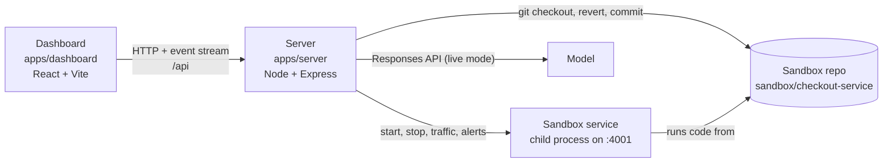

# Architecture

War Room is a pnpm monorepo with two apps and a sandbox it creates at runtime.



## Repository layout

```text
apps/
  server/                Node.js + Express + TypeScript
    src/
      index.ts           HTTP routes, startup and shutdown
      incident.ts        the incident pipeline: deploy, alert, agents, fix, verify, postmortem
      agents.ts          model calls, streaming, shared instructions
      demo-scripts.ts    scripted replies for demo mode
      service.ts         starts and stops the sandbox service, traffic, alerts, error rate
      git.ts             git helpers and sandbox seeding
      events.ts          event stream with replay for late joiners
      scenarios.ts       the scenario list
      config.ts          settings from .env
      util.ts            small helpers
    runtime/
      exit-with-parent.cjs   preloaded into the sandbox service so it exits with the server
  dashboard/             React + Vite + TypeScript
    src/
      App.tsx            page layout and the deploy request
      useWarRoom.ts      event stream subscription and state reducer
      types.ts           event payload types
      components/        Header, AlertPanel, ScenarioPanel, AgentFeed, Results, Markdown
scripts/
  seed-demo-repo.js      writes the sandbox service and its git history
  e2e-demo.mjs           end-to-end test of every scenario in demo mode
website/                 the landing page (static HTML, CSS and a recorded replay)
docs/                    this documentation (MkDocs)
```

## The sandbox

`scripts/seed-demo-repo.js` creates a standalone git repository with a small checkout service in plain Node.js (no
dependencies) and one branch per scenario. The server runs that service as a child process and talks to it over HTTP:

| Endpoint              | Purpose                                                      |
| --------------------- | ------------------------------------------------------------ |
| `GET /health`         | Health check, also reports database pool usage               |
| `POST /checkout`      | One checkout; logs `checkout_completed` or `checkout_failed` |
| `POST /traffic/start` | Clears the log and starts synthetic checkout traffic         |
| `POST /traffic/stop`  | Stops the traffic                                            |
| `GET /alerts/latest`  | Returns an alert when the recent error rate is 20% or more   |

The service writes JSON lines to `sandbox/checkout-service/logs/app.log`. Those lines are what the Log Detective reads
and what recovery is measured from.

The service is started with a minimal environment, so it never sees your API key, and with an IPC channel so it exits
when the server exits.

## The event stream

The server keeps a replay buffer of the current incident. Token-by-token deltas from the same agent are merged in the
buffer, so it grows with the number of steps rather than tokens. Every new connection first receives a `hello` event,
then the replay, then live events. This is why refreshing the dashboard never loses state. See
[Event stream](../reference/events.md).

## The dashboard

The dashboard is a single page. `useWarRoom.ts` opens the event stream and folds every event into one state object
with a reducer. Components only read that state. The dashboard never polls; it only reacts to events. During
development, Vite forwards `/api` to the server. In production, the server hosts the built dashboard itself.
