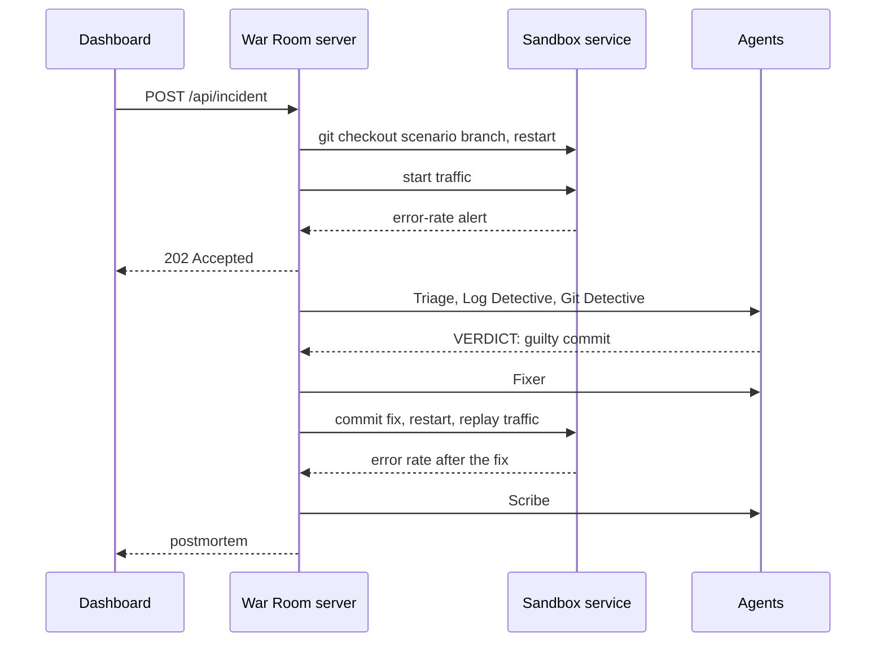

# Incident lifecycle

This page follows one incident from the button press to the postmortem. The code for every step is in
`apps/server/src/incident.ts`.

Every step also publishes events on the [event stream](../reference/events.md), which is how the dashboard updates live.

## 1. Deploy

War Room checks that no other incident is running (only one runs at a time), then:

1. Creates the sandbox repository if it doesn't exist yet.
2. Records the **last known good** commit: where the scenario branch split from `main`.
3. Checks out the scenario branch and restarts the sandbox service from it.

Status: `DEPLOYING`.

## 2. Detect

War Room starts synthetic traffic: a burst of checkout requests, then one every 150 ms. The service writes each
result to its JSON log. Every second, War Room asks the service for an alert. The service raises one when, in the last
five seconds, there were at least five checkouts and 20% or more failed.

If no alert arrives within 15 seconds, the deploy fails and the status becomes `FAILED`.

Status: `CRITICAL`.

## 3. Investigate

War Room collects the evidence:

- the last 50 lines of the service log
- `git log` from the last known good commit to the deployed commit
- the full diff of every commit in that range, cut at 60 000 characters

Then the agents run one after another. Each one receives the previous agents' conclusions.

1. **Triage** gets the alert and returns a severity and a plan.
2. **Log Detective** gets the alert and logs and returns ranked hypotheses with quoted log lines.
3. **Git Detective** gets the commit log and diffs and must end its reply with `VERDICT: <sha>`.

War Room accepts the verdict only if the SHA matches exactly one commit in the deployed range. Otherwise the incident
stops with an error.

Status: `INVESTIGATING`.

## 4. Fix

The **Fixer** gets the guilty commit's diff and the deployed `src/index.js` and returns a corrected file. What War Room
does next depends on the mode.

**Live mode.** War Room creates a `fix/<scenario>` branch and keeps the AI patch only if it passes every check:

1. It looks like the service (it contains `http.createServer`).
2. It parses: `node --check` succeeds.
3. It changes something.
4. The service starts with it.
5. The error rate measured afterwards is below 20%.

If any check fails, War Room throws the patch away and reverts the guilty commit instead.

**Demo mode.** War Room reverts the guilty commit with `git revert`.

Either way, the fix is measured: War Room restarts the service, replays traffic for five seconds and counts failed
checkouts.

Status: `FIXING`, then `RESOLVED` if the error rate is below 20%, or back to `CRITICAL` with a message if not.

## 5. Postmortem

The **Scribe** gets every agent's conclusion, the guilty commit, the before and after error rates and a timeline built
from the incident's events with their real timestamps. Its report is saved to
`sandbox/postmortems/<timestamp>-<scenario>.md` and shown in the dashboard.

## When something fails

Any error stops the incident and sets the status to `FAILED` with the reason. The agent that failed (if any) shows the
error in the feed. The lock is released, so you can deploy again straight away.
