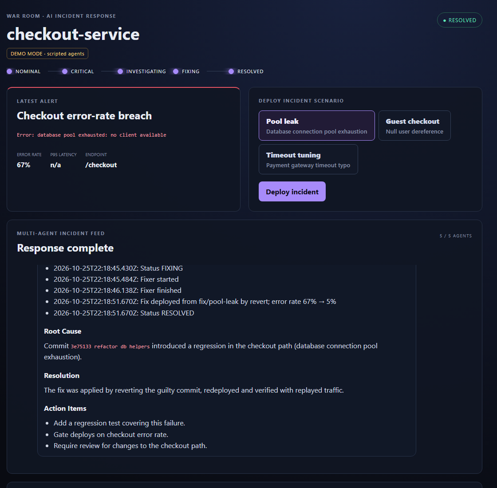

# War Room

War Room is an open-source AI incident-response team. It deploys a real bug into a small checkout service, waits for
the error-rate alert, and then five AI agents work the incident: they read the alert and logs, name the commit that
caused it, ship a fix, measure that the service recovered and write the postmortem. A dashboard shows each step live.

[Quick start](getting-started/quickstart.md){ .md-button .md-button--primary }
[Watch a recorded incident](https://hasipfaruk.github.io/War-Room/){ .md-button }

## What you can do with it

- **Watch an AI incident response from start to finish.** Pick one of three built-in bugs and see the agents find it.
- **Run it with or without an API key.** Without a key, War Room runs in demo mode: the agents' text is scripted,
  but the deploy, the errors, the git revert and the recovery numbers are real.
- **Build on it.** The server exposes a small HTTP API and a live event stream, so you can build your own dashboard,
  add incident scenarios or change how the agents work.

## Where to go next

| I want to...                                  | Read                                             |
| --------------------------------------------- | ------------------------------------------------ |
| Run War Room on my machine                    | [Quick start](getting-started/quickstart.md)     |
| Understand what happens during an incident    | [Incident lifecycle](concepts/lifecycle.md)      |
| Build a different UI on top of the server     | [Build your own dashboard](develop/custom-ui.md) |
| Add a new bug for the agents to find          | [Add a scenario](develop/scenarios.md)           |
| Change prompts or add an agent                | [Add or change an agent](develop/agents.md)      |
| Know what is safe to run, and what is not yet | [Security](project/security.md)                  |

## Status

War Room is a working reference for an AI incident loop. Today it only runs against its bundled sandbox service, not
your own systems. The [roadmap](project/roadmap.md) lists what is planned and where help is welcome.

War Room is released under the [MIT License](https://github.com/hasipfaruk/War-Room/blob/main/LICENSE).
